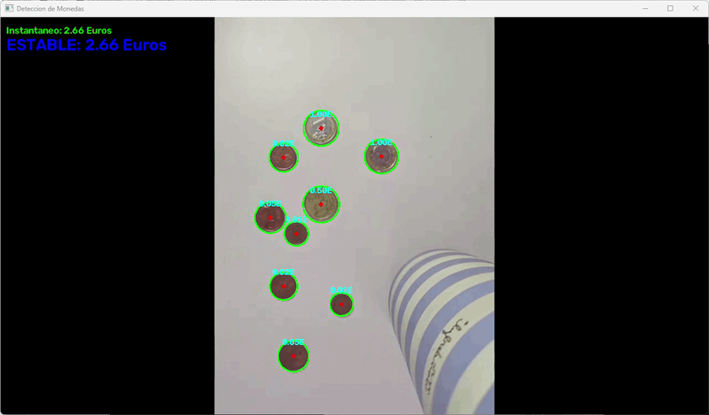
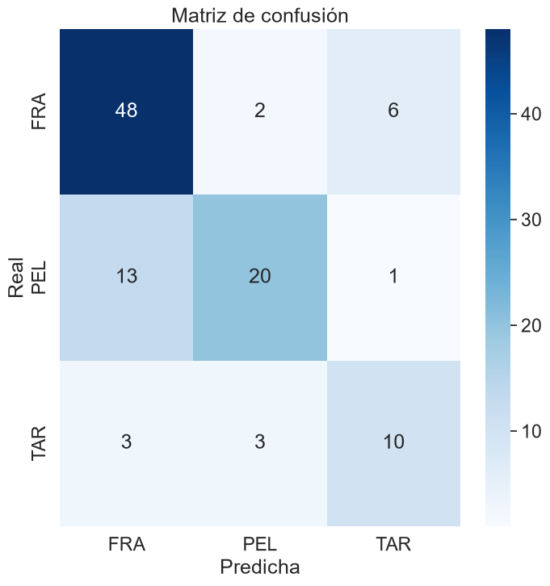

# Práctica 3 de Visión por Computador

## Autoría

* Beatriz Chaves Marrero | https://github.com/bezz75
* Marcos Peña Armario | https://github.com/marcpear

## Descripción

Este repositorio contiene el cuaderno "VC_P3.ipynb", correspondiente a la tercera práctica de la asignatura Visión por Computador.

El cuaderno incluye:

* Detección y conteo de monedas en tiempo real a través de una cámara web.
* Identificación de partículas mediante la extracción y aprendizaje de características sin el uso de modelos de aprendizaje profundos.

Las tareas relacionadas con la cámara necesitan una cámara web. Para finalizar las ventanas de OpenCV hay que pulsar 'ESC'.

## Resultados

**Tarea 1:** Identificación y conteo en vivo de monedas junto al cálculo del valor total sin modelos de aprendizaje profundo.

**Resultado:** En un principio se intentó realizar la clasificación de las monedas basándose únicamente en su diámetro, utilizando una moneda de 50 céntimos como patrón de calibración. Sin embargo, este método generaba bastantes falsos positivos. Para solucionar este problema y evitar confundir monedas de tamaños similares (como la de 1 euro y la de 5 céntimos), se integró un análisis de color como segunda capa de validación.

**Tarea 2:** Desarrollo de clasificador de partículas mediante la extracción e identificación de características sin modelos de aprendizaje profundo.

**Resultado:** 

![Resultado Tarea 2.2](Resultados/tarea2_2.png

## Fuentes consultadas

## Uso de IA

En la primera tarea se usó la Inteligencia Artificial para resolver dudas sobre posibles implementaciones y limpieza y refactorización de código de código 

