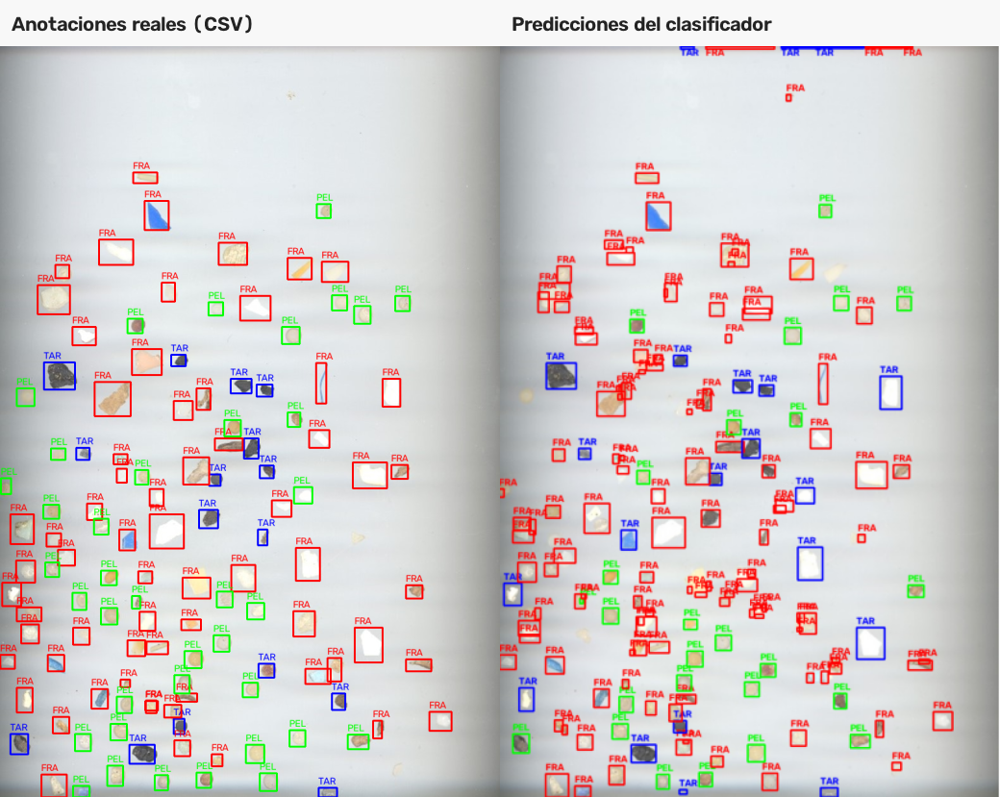
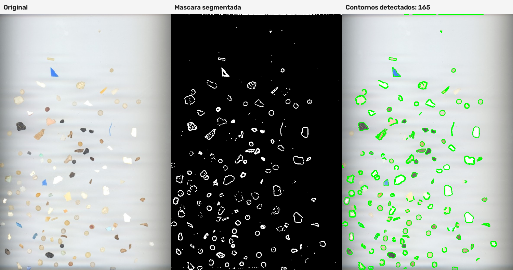

# Práctica 3 de Visión por Computador

## Autoría

* Beatriz Chaves Marrero | https://github.com/bezz75
* Marcos Peña Armario | https://github.com/marcpear

## Descripción

Este repositorio contiene el cuaderno "VC_P3.ipynb", correspondiente a la tercera práctica de la asignatura Visión por Computador.

El cuaderno incluye:

* Detección y conteo de monedas en tiempo real a través de una cámara web.
* Identificación de partículas mediante la extracción y aprendizaje de características sin el uso de modelos de aprendizaje profundos.

Las tareas relacionadas con la cámara necesitan una cámara web. Para finalizar las ventanas de OpenCV hay que pulsar 'ESC'.

## Ejecución

El cuaderno `VC_P3.ipynb` se puede abrir con Jupyter Notebook o Visual Studio Code con la extensión de Jupyter.

Instalaciones necesarias:

```bash
pip install opencv-python numpy matplotlib scikit-learn
```

## Resultados

**Tarea 1:** Identificación y conteo en vivo de monedas junto al cálculo del valor total sin modelos de aprendizaje profundo.


**Resultado:** En un principio se intentó realizar la clasificación de las monedas basándose únicamente en su diámetro, utilizando una moneda de 50 céntimos como patrón de calibración. Sin embargo, este método generaba bastantes falsos positivos. Para solucionar este problema y evitar confundir monedas de tamaños similares (como la de 1 euro y la de 5 céntimos), se integró un análisis de color como segunda capa de validación.


**Tarea 2:** Desarrollo de clasificador de partículas mediante la extracción e identificación de características sin modelos de aprendizaje profundo.


**Resultado:** Primero se segmentaron las partículas de las imágenes de entrenamiento y de la imagen de prueba mediante umbralizado adaptativo, filtrado morfológico y extracción de contornos. Para cada partícula se calcularon características geométricas y de color.

Las características se normalizaron y se calculó el centroide de cada clase. La etiqueta de cada partícula de prueba se decidió asignándola a la clase cuyo centroide estaba más próximo. 

El sistema detectó 165 partículas en la imagen de prueba; para evaluar la clasificación, se asociaron las detecciones con las anotaciones del archivo `MPs_test_bbs.csv` usando la intersección sobre unión (IoU) de sus cajas delimitadoras, con un umbral superior a 0,3. La matriz de confusión y la exactitud se calcularon sobre las 106 detecciones asociadas.

La exactitud obtenida fue del **73,58 %** (78 clasificaciones correctas de 106). La matriz muestra que los fragmentos fueron la clase mejor reconocida: 48 de 56 se clasificaron correctamente. En cambio, hubo más confusiones entre pellets y fragmentos: 13 pellets se clasificaron como fragmentos. También se identificaron correctamente 20 de 34 pellets y 10 de 16 partículas de alquitrán.


Estos resultados muestran que la combinación de características permite distinguir razonablemente las clases, aunque todavía se producen errores, especialmente entre pellets y fragmentos. La siguiente comparativa muestra las anotaciones reales de la imagen de prueba junto a las predicciones del clasificador.



La segmentación de las partículas se muestra a continuación:



## Fuentes consultadas

 - **Documentación de opencv**
https://docs.opencv.org/4.13.0/dd/d49/tutorial_py_contour_features.html

- **SMACC: A System for Microplastics Automatic Counting and Classification**:
https://ieeexplore.ieee.org/document/8976153


## Uso de IA

En la primera tarea se usó la Inteligencia Artificial como apoyo para resolver dudas sobre posibles implementaciones y para revisar, limpiar y refactorizar el código.

En la segunda tarea se consultó la Inteligencia Artificial para explorar alternativas de preprocesamiento y mejorar la segmentación de las partículas antes de extraer sus características. Las sugerencias de la IA se tomaron como orientación y se adaptaron al problema y a los resultados obtenidos en las imágenes de prueba.
