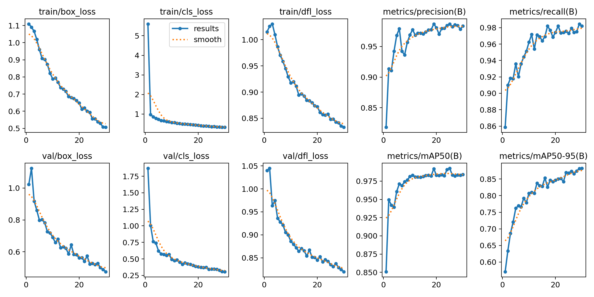
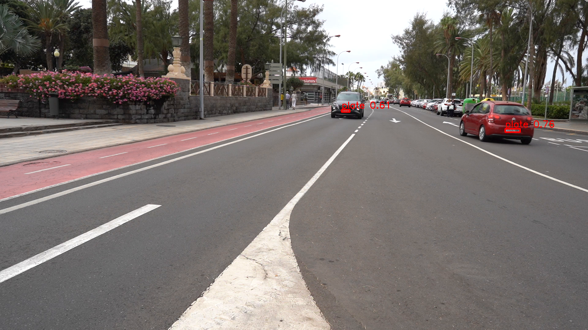
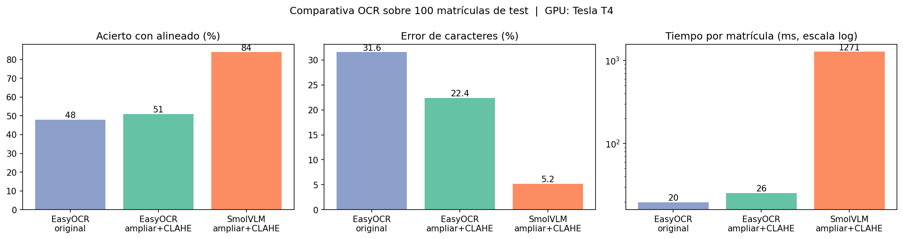

# Práctica 4a y 4b de Visión por Computador

## Autoría

* Beatriz Chaves Marrero | https://github.com/bezz75
* Marcos Peña Armario | https://github.com/marcpear

## Descripción

Este repositorio contiene los cuardernos `VC_P4a.ipynb` y `VC_P4b.ipynb`, los cuales corresponden a la práctica 4a y 4b de la asignatura Visión por Computador. Se ejecutaron en Google Colab (GPU NVIDIA T4) para disponer de GPU.

Práctica 4a. Prototipo que procesa el vídeo de test para detectar y seguir personas y vehículos, detectar las matrículas de los vehículos, contar el total de cada clase y volcar a disco un vídeo anotado y un CSV. Combina dos detectores:

YOLO11n preentrenado (COCO) con el seguimiento BoT-SORT de Ultralytics, para personas, bicicletas, coches, motos, autobuses y camiones.
YOLO11n ajustado para matrículas, entrenado con UC3M-LP (una sola clase, license_plate).

Práctica 4b. Añade el reconocimiento del texto de las matrículas (OCR). Compara EasyOCR con SmolVLM y los integra en el pipeline, que genera el vídeo y los CSV con el texto leído.

<<Sección 4b: se revisará en el siguiente paso>>

## Dataset

Se ha usado un dataset externo [UC3M-LP](https://github.com/ramajoballester/UC3M-LP) que contiene fotografías nocturnas de 5184×3888 píxeles con varios coches por imagen (hasta dos matrículas por imagen), con una anotación .json por imagen que incluye el polígono de cada matrícula y su texto. Este dataset se ha preparado y tratado para su utilización en la práctica creando un script que hizo lo siguiente:

- Empareja cada imagen con su JSON por nombre de archivo.
- Convierte el polígono de cada matrícula en la caja delimitadora YOLO de la clase license_plate, normalizada con el tamaño de imagen indicado en el JSON.
- Conserva las particiones originales de entrenamiento y prueba y separa aleatoriamente (semilla 42) un 20 % del entrenamiento como validación.
- Genera el YAML de configuración y ground_truth.csv, con el texto de referencia y las coordenadas de cada matrícula para la práctica 4b. Los asteriscos del texto son caracteres ocultos o ilegibles y deben tratarse como comodines al evaluar el OCR.

Para reducir el tiempo de lectura de las imágenes en Colab, el cuaderno trabaja con una copia reducida a 1920 píxeles de ancho (UC3M_RS.zip); las etiquetas, al estar normalizadas, no cambian.

| Partición | Imágenes | Matrículas |
|---|---|---|
| Entrenamiento | 1264 | 1667 |
| Validación | 316 | 389 |
| Prueba | 395 | 491 |

El conjunto procesado (`UC3M_RS.zip`) se descarga automáticamente desde el cuaderno. <<Enlace de descarga>>

## Ejecución

Los cuadernos están preparados para Google Colab, para poder ejecutarlos se debe:

1. Abrir `VC_P4a.ipynb` o `VC_P4b.ipynb` en Google Colab.
2. Seleccionar un entorno de ejecución con GPU (la ejecución registrada se hizo con una T4).
3. Ejecutar las celdas en orden. Los cuadernos descargan el dataset, el vídeo y los pesos desde los enlaces de la sección de configuración, por lo que solo hay que descargar los cuadernos.

El entrenamiento del detector de matrículas (sección 4.1 de VC_P4a.ipynb) es opcional y tarda unos 60 minutos en una T4; si se omite, el cuaderno descarga los pesos ya entrenados (best.pt, 5,5 MB). <<Enlace a los pesos y/o ruta en el repositorio>>

Los parámetros principales del detector de matrículas (Práctica 4a):

* Modelo inicial: `yolo11n.pt`.
* Resolución de entrenamiento: 1280 píxeles.
* Épocas: 40, con paciencia de 10.
* Tamaño de lote: 4.
* Optimizador: AdamW con selección automática de Ultralytics (lr inicial 0,002)
* Clase: `license_plate`.

## Resultados

### Práctica 4A: Detección de vehículos y matrículas:

Se entrenó YOLO11n durante 40 épocas (59 minutos en una T4, unos 89 s por época). Las pérdidas de entrenamiento y validación descienden juntas y sin divergir: box_loss pasa de 1,11 a 0,47 en entrenamiento y de 1,02 a 0,48 en validación; cls_loss baja de 5,60 (primera época, con la cabeza de clasificación todavía sin ajustar) a 0,30; dfl_loss, de 1,02 a 0,83.

Al final la pérdida de validación es similar a la de entrenamiento, por lo que no se ve sobreajuste.

El mAP@0.5 supera 0,95 en la segunda época y se mantiene entre 0,97 y 0,99 desde la época 10. El mAP@0.5:0.95, que exige cajas más precisas, mejora de forma sostenida: 0,57 en la primera época, 0,79 en la décima, 0,85 en la vigésima y 0,89 en la última. Su media sube de 0,855 (épocas 21-30) a 0,876 (épocas 31-40), lo que coincide con el cierre del aumento mosaic en las últimas diez épocas y con el descenso del learning rate (de 1,9·10⁻³ a 7·10⁻⁵). La mejor época fue la 40 y la parada anticipada no se activó, así que más épocas podrían refinar algo más las cajas.

Estas métricas se miden sobre UC3M-LP (fotografías nocturnas con matrículas grandes), no sobre el vídeo de test, para el que no disponemos de anotaciones.

Ejemplo de detección de matrículas en un fotograma del vídeo:

La demostración de vídeo procesa un tramo de 30 segundos: las cajas verdes y sus 
identificadores corresponden al seguimiento de personas y vehículos; las cajas rojas 
muestran las matrículas detectadas.

[Descargar el vídeo de demostración P4a](Resultados_P4a/video_demostracion.mp4)

#### Pipeline sobre el vídeo de test

El vídeo (1920×1080, 25 fps, 2832 fotogramas) se procesa en dos pasadas:

1. **Detección y seguimiento.** YOLO11n preentrenado con BoT-SORT sobre personas, bicicletas, coches, motos, autobuses y camiones. Para cada vehículo se busca la matrícula **dentro de su recorte** con el detector entrenado (umbral 0,25 y entrada de 640 px), de esta manera la matrícula ocupa un tamaño parecido al visto en el entrenamiento, y queda asociada al identificador del vehículo.
2. **Salida.** Cada identificador recibe su clase más frecuente a lo largo del vídeo, y solo se cuentan los identificadores presentes en al menos 25 fotogramas, para no contar detecciones esporádicas. Se escribe el vídeo anotado a resolución original (cajas verdes con identificador y clase, cajas rojas para matrículas, contador en pantalla) y los CSV.

Archivos de salida: <<enlaces o rutas>>

* `salida_p4a.mp4`: vídeo anotado.
* `resultado_p4a.csv`: una fila por detección (9725 filas) con `fotograma, tipo_objeto, confianza, identificador_tracking, x1, y1, x2, y2, matricula, confianza_matricula, mx1, my1, mx2, my2, texto_matricula`. `matricula` indica si se detectó matrícula; `texto_matricula` queda vacío en 4a y lo rellena la práctica 4b.
* `resumen_vehiculos_p4a.csv`: una fila por identificador con su clase, primer y último fotograma, número de fotogramas, si es estable y si se detectó matrícula.

#### Conteo y validación manual

Contamos a mano los elementos del vídeo y los comparamos con el sistema:

| Clase | Manual | Sistema: identificadores totales | Sistema: estables (≥25 fotogramas) |
|---|---|---|---|
| Personas | 14 | 16 | 13 |
| Coches | 30 | 40 | 38 |
| Guaguas | 1 | 1 | 1 |
| Motos | 3 | 1 | 0 |
| Bicicletas | 2 | 1 | 0 |
| Matrículas (sin las 2 mátriculas de moto) | 27 | 31 | 31 |

El sistema detecta matrícula en 31 de los 39 vehículos estables.

#### Limitaciones

* **Coches sobrecontados** (38 frente a 30): el seguimiento pierde y recupera algunos vehículos, sobre todo los aparcados o parcialmente tapados, y les asigna identificadores nuevos. Esto también explica que haya más matrículas contadas (31) que visibles (27).
* **Motos y bicicletas infravaloradas**: cruzan rápido, aparecen pocos fotogramas y el filtro de 25 fotogramas las descarta. Además, el detector de matrículas no detecta las de las motos (el dataset es de coches y esas matrículas son pequeñas).
* **Matrículas lejanas**: a partir de cierta distancia la matrícula mide pocas decenas de píxeles y se pierde.
* **Métricas del detector** medidas en UC3M-LP, no en el vídeo; para el vídeo solo disponemos de la comparación de conteos anterior.

### Práctica 4B: reconocimiento de caracteres en matrículas (OCR):

Se compara un OCR clásico (**EasyOCR**) con un modelo visión-lenguaje (**SmolVLM-Instruct**, `HuggingFaceTB/SmolVLM-Instruct`) y se integra el OCR en el pipeline de la práctica 4a, de modo que el texto leído aparece sobre la matrícula en el vídeo y en la columna `texto_matricula` del CSV.

#### Condiciones de la comparativa

* **Datos:** 100 recortes de matrículas aleatorios (semilla 42) de la partición de **test** de UC3M-LP, recortados con las cajas del `ground_truth.csv`. Solo se usan matrículas con 2 o menos caracteres censurados. Los mismos 100 recortes se usan en todos los métodos.
* **Preprocesado:** se probó el recorte original, ampliado a ~100 px de alto y ampliado + CLAHE. Para la comparación final EasyOCR y SmolVLM reciben la misma entrada (ampliar + CLAHE).
* **Tiempos:** una lectura de calentamiento descartada y 3 pasadas sobre los 100 recortes; se da la mediana de las medias de cada pasada. Los tres métodos se miden con la misma función, en la misma sesión.
* **Máquina:** GPU NVIDIA Tesla T4 (Google Colab), PyTorch 2.14.1+cu130. <<PENDIENTE: CPU, RAM y versión de Python que imprime la primera celda>>
* **Métricas** (los `*` del texto de referencia son caracteres censurados en la imagen):
  * *Acierto estricto* (la definición del enunciado): misma longitud y todos los caracteres iguales; el `*` casa con cualquier carácter.
  * *Acierto con alineado*: igual que el anterior, pero calculado con distancia de edición, donde `*` casa con cualquier carácter **o con ninguno**. Es la medida justa si el OCR no lee un bloque gris.
  * *CER*: errores de carácter sobre el total de caracteres visibles.

#### Resultados (100 matrículas de test)

| Método | Acierto estricto | Acierto con alineado | CER | Tiempo por matrícula |
|---|---|---|---|---|
| EasyOCR, recorte original | 7,0 % | 48,0 % | 31,6 % | <<PENDIENTE: medir con `pasadas()`>> |
| EasyOCR, ampliar | 6,0 % | 46,0 % | 26,2 % | <<PENDIENTE>> |
| **EasyOCR, ampliar + CLAHE** | 6,0 % | 51,0 % | 22,4 % | 25 ms |
| **SmolVLM, ampliar + CLAHE** | 1,0 % | **84,0 %** | **5,2 %** | 1264 ms |

Con la medición única de las tres variantes, los tiempos de EasyOCR (original y ampliar) quedan <<PENDIENTE>>. En una ejecución anterior (medición distinta) fueron ~21 ms y ~29 ms. SmolVLM es **~51 veces más lento** que EasyOCR con la misma entrada (1264 ms frente a 25 ms). <<PENDIENTE: confirmar el factor tras ejecutar la celda 2.7>>

**¿Ayuda el formato de matrícula?** Se probaron dos ideas, y ninguna mejora:

| Variante | Acierto estricto | Acierto con alineado | CER |
|---|---|---|---|
| EasyOCR (ampliar + CLAHE) + corrección por formato | 6,0 % | 45,0 % | 25,8 % |
| SmolVLM + corrección por formato | 1,0 % | 83,0 % | 5,6 % |
| SmolVLM con prompt que describe el formato | 1,0 % | 71,0 % | 12,0 % |
| SmolVLM con prompt de formato + corrección | 1,0 % | 70,0 % | 12,4 % |

La corrección por formato (sustituir confusiones típicas como `O→0`, `I→1`) empeora ligeramente ambos resultados, y el prompt que describe el formato empeora claramente a SmolVLM. Por eso el pipeline usa el prompt base. La corrección por formato **sí** se mantiene en el pipeline para otro fin: descartar lecturas que no pueden ser una matrícula (por ejemplo, textos de más de 8 caracteres), en lugar de guardarlas en el CSV.

#### Por qué el acierto estricto es tan bajo

Con la métrica estricta el acierto de SmolVLM es 1 %, pese a leer bien la mayoría de los caracteres (CER 5,2 %). La causa es que muchas referencias contienen `*` (caracteres censurados en el dataset), y la métrica estricta exige que el texto leído tenga **la misma longitud** que la referencia. El OCR lee los caracteres visibles y no inventa uno en cada bloque gris, por lo que casi nunca coincide en longitud. Por eso damos también el acierto con alineado y el CER, que miden lo que el OCR realmente acierta.

#### Pipeline sobre el vídeo con OCR

El pipeline es el de 4a (misma detección de matrículas dentro del recorte del vehículo, mismo seguimiento, clase mayoritaria por ID y 25 fotogramas mínimos) con estas adiciones:

* El OCR (SmolVLM, ampliar + CLAHE) solo se aplica si la matrícula mide al menos 50 px de ancho y su proporción ancho/alto está entre 1,5 y 7. Se recortan con un 8 % de margen.
* Se hacen hasta 3 lecturas válidas por vehículo (máximo 8 intentos, separadas 8 fotogramas como mínimo).
* Una lectura solo se acepta si encaja en el formato de matrícula española (nueva: 4 dígitos + 3 consonantes; antigua: 1-2 letras + 4 dígitos + 1-2 letras), tras corregir como mucho 2 confusiones típicas.
* El texto final de cada vehículo se obtiene por votación ponderada con la confianza de la detección. El vídeo y el CSV muestran el texto votado con las lecturas obtenidas hasta ese fotograma.

Archivos de salida: <<enlaces o rutas>>

* `salida_p4.mp4`: vídeo anotado con el texto leído sobre cada matrícula.
* `resultado.csv`: una fila por detección con los campos de 4a y `texto_matricula` relleno.
* `resumen_vehiculos.csv`: una fila por identificador, con número de lecturas válidas y texto final.

Resultados sobre el vídeo (<<PENDIENTE: ejecutar el cuaderno completo y completar>>):
[Descargar el vídeo de demostración P4b](Resultados_P4b/video_demostracion_b.mp4)

| Concepto | Valor |
|---|---|
| Vehículos estables | <<PENDIENTE>> |
| con matrícula detectada | <<PENDIENTE>> |
| con texto leído | <<PENDIENTE>> |
| Tiempo medio de OCR por lectura en el pipeline | <<PENDIENTE>> ms |

<<PENDIENTE: leer a mano 10-15 matrículas del vídeo y dar una precisión aproximada. El vídeo no tiene anotaciones de matrícula, así que sin esto no hay forma de medir el acierto sobre el vídeo.>>

#### Conclusiones

* **Precisión:** SmolVLM es claramente más preciso que EasyOCR sobre matrículas nocturnas: 84 % frente a 51 % de acierto con alineado, y 5,2 % frente a 22,4 % de error de caracteres. Lee mucho mejor las matrículas desenfocadas y con poco contraste.
* **Velocidad:** EasyOCR es unas 50 veces más rápido. Para procesar un vídeo largo es el límite práctico del VLM, que en nuestro pipeline solo se ejecuta unas pocas veces por vehículo, no en cada fotograma.
* **Preprocesado:** ampliar y aplicar CLAHE ayuda a EasyOCR (CER de 31,6 % a 22,4 %), pero no lo acerca al VLM.
* **Formato:** inyectar conocimiento del formato (prompt o corrección) no mejoró la lectura en nuestras pruebas. Su utilidad real es filtrar lecturas imposibles.
* **Limitaciones:** la comparativa se hizo con matrículas de UC3M-LP (nocturnas, grandes), no con las del vídeo de test; en el vídeo las matrículas lejanas son pequeñas y están desenfocadas, así que el acierto allí será menor. La votación carácter a carácter puede producir una lectura que ninguna lectura individual contenía.

## Fuentes consultadas

* [Documentación oficial de Ultralytics YOLO11](https://docs.ultralytics.com/models/yolo11/)
* [UC3M-LP: dataset de detección y reconocimiento de matrículas](https://github.com/ramajoballester/UC3M-LP)
* Ramajo-Ballester, A., Armingol, J. M. y de la Escalera, A. [Dual license plate recognition and visual features encoding for vehicle identification](https://doi.org/10.1016/j.robot.2023.104608)
* [EasyOCR](https://github.com/JaidedAI/EasyOCR)
* [SmolVLM-Instruct](https://huggingface.co/HuggingFaceTB/SmolVLM-Instruct)

## Uso de IA

Para la realización de esta práctica se utilizó la IA de manera didáctica y como forma de comprobar y contrastar resultados, además, todo código proporcionado por la IA fue revisado y comprobado antes de la entrega.

Para esta práctica se utilizó **Claude** (Anthropic) como asistente. Su uso se resume así:

**Con ayuda de la IA**
* Explicación y depuración de los cuadernos (errores de rutas, formato del dataset, métricas).
* Propuesta de métricas de evaluación del OCR (acierto con alineado y CER, además de la métrica estricta del enunciado) y del procedimiento de medición de tiempos.
* Diseño de la descarga automática del dataset, los pesos y el vídeo para que el cuaderno sea reproducible.
* Arreglos del dataset utilizado UC3M-LP.
* Reordenación de los cuadernos sin cambiar su ejecución, y revisión de los cuadernos y de este README frente a los enunciados.
* Corrección de partes de este README.

Los resultados numéricos de este documento proceden de nuestras ejecuciones; no fueron generados por la IA.
