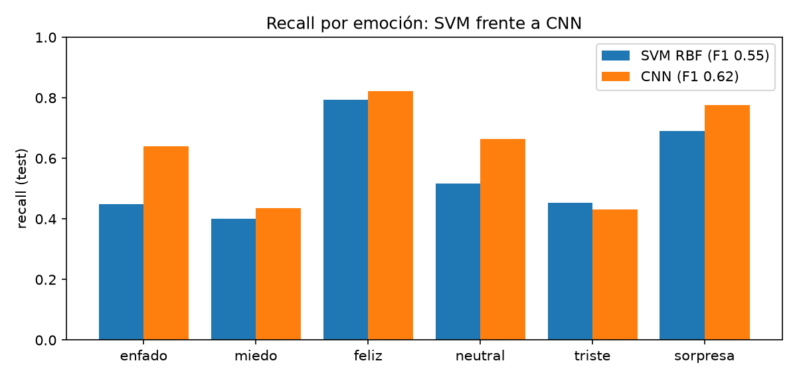
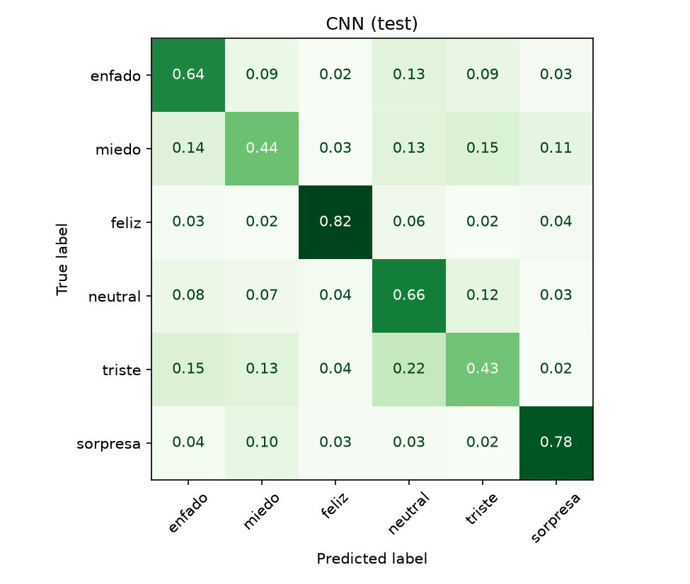
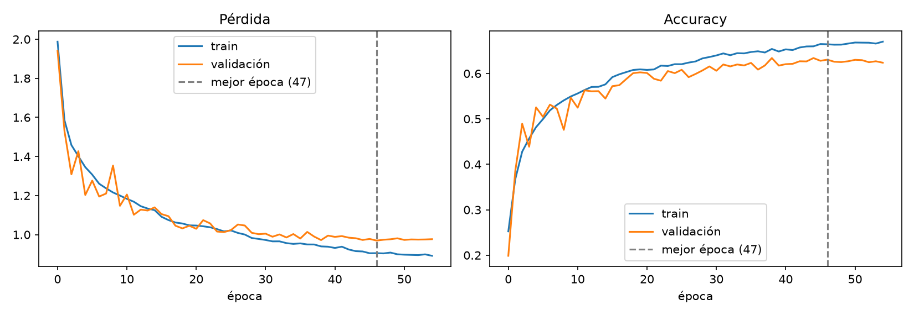

# Práctica 5. Biometría: detección y caracterización de caras

## Índice

- [Autoría](#autoría)
- [Descripción](#descripción)
- [Recursos y datos](#recursos-y-datos)
- [Entorno y ejecución](#entorno-y-ejecución)
- [Prototipo 1: filtro de emociones](#prototipo-1-filtro-de-emociones)
- [Prototipo 2: Fruit Ninja](#prototipo-2-fruit-ninja)
- [Resultados y evaluación](#resultados-y-evaluación)
- [Robustez y limitaciones](#robustez-y-limitaciones)
- [Conclusiones](#conclusiones)
- [Referencias](#referencias)
- [Uso de IA](#uso-de-ia)

## Autoría

- [Marcos Peña Armario](https://github.com/marcpear)

- [Beatriz Chaves Marrero](https://github.com/bezz75)

## Descripción

La práctica propone dos prototipos que generen una reacción a partir de información obtenida del rostro. El primero debe utilizar un modelo entrenado por el equipo para extraer información biométrica; el segundo es de temática libre. Se debe describir el detector utilizado, justificar el conjunto de datos y discutir la robustez y los resultados de cada propuesta.

### Filtro 1 — Emociones

Filtro de realidad aumentada que reconoce la emoción de la persona con un modelo entrenado por nosotros y, según la emoción, le pone las orejas y otros rasgos de un Pokémon, junto con un detalle animado propio de esa emoción.

| Emoción | Pokémon | Piezas | Detalle animado |
|---|---|---|---|
| Feliz | Pikachu | Orejas y mofletes | Chispas que parpadean |
| Sorpresa | Psyduck | Pelo y pico | Exclamación que late |
| Triste | Eevee | Orejas y busto | Lágrimas que caen |
| Enfado | Mankey | Orejas y hocico | Símbolo de enfado que late |
| Miedo | Meowth | Moneda y bigotes | Gota de sudor que cae |
| Neutral | Snorlax | Orejas y colmillos | "Zzz" flotando |

### Filtro 2 — Fruit Ninja

Juego de cortar frutas en tiempo real parecido al conocido juego "Fruit Ninjas". El jugador elige entre controlar el corte con la nariz o con la punta del dedo índice.

## Recursos y datos

### Filtro 1 — Emociones

- **Dataset:** [FER2013](https://www.kaggle.com/datasets/msambare/fer2013), con caras de 48×48 px en escala de grises ya separadas en train (28.273 imágenes usadas) y test (7.067). No se incluye en el repositorio: los notebooks lo descargan de Kaggle con `kagglehub` si no existe la carpeta `pokemon_emociones/data/fer2013`.
- **Clases:** 6 de las 7 originales: enfado, miedo, feliz, neutral, triste y sorpresa. Se descartó *disgust* porque solo tiene 436 imágenes de entrenamiento, frente a más de 3.000 del resto. Las clases siguen desequilibradas (feliz tiene 2,3 veces más imágenes que sorpresa), lo que se compensa con pesos por clase.
- **Preparación:** cada cara se redimensiona a 48×48 y se ecualiza su histograma. El mismo preprocesado (`emociones_utils.py`) se aplica al entrenar y en la webcam.
- **Modelo entrenado:** se compararon descriptores clásicos (HOG y LBP) con una SVM frente a una red convolucional propia. El prototipo usa la CNN, que obtuvo mejores resultados (F1 macro 0,621 frente a 0,554).

Las piezas de los Pokémon se dibujaron en Procreate como PNG con fondo transparente (`pokemon_emociones/assets/pokemons`). Los detalles de las emociones están en `pokemon_emociones/assets/emociones`.

### Filtro 2 — Fruit Ninja

No necesita un dataset de entrenamiento propio. Usa MediaPipe Face Landmarker para localizar la nariz y colocar la bandana, y Hand Landmarker para detectar la punta del índice.

Las imágenes PNG del juego están en `fruit_ninja/assets`.

## Entorno y ejecución

### Requisitos

- Python 3.11 y una cámara web.
- Conexión a Internet solo la primera vez: para descargar FER2013 si se reentrenan los modelos y, si falta, el modelo `hand_landmarker.task`.

Los dos prototipos usan el mismo entorno de conda:

```
conda create --name VC_P5 python=3.11
conda activate VC_P5
pip install numpy matplotlib scikit-learn scikit-image joblib kagglehub
pip install mediapipe tensorflow
```

MediaPipe ya instala OpenCV (`opencv-contrib-python`), así que no hace falta instalar `opencv-python` aparte.

### Estructura

```
P5/
├── comun/
│   └── filtro_utils.py      funciones compartidas por los dos prototipos
├── modelos/                 face_landmarker.task y hand_landmarker.task (MediaPipe)
├── pokemon_emociones/
│   ├── detector_emociones_filtro_pokemon.py   programa principal
│   ├── catalogo.py          imágenes, piezas de cada Pokémon y emoción asociada
│   ├── dibujo.py            carga los PNG y dibuja las piezas del catálogo
│   ├── emociones_utils.py   preprocesado y características (HOG, LBP)
│   ├── clasificadores.py    carga y uso de la CNN y la SVM
│   ├── notebooks/           exploración del dataset y entrenamiento
│   ├── modelos/             modelo_emociones_cnn.keras y modelo_emociones.joblib
│   ├── assets/              PNG de los Pokémon y de los detalles
│   └── resultados/          gráficas y métricas
└── fruit_ninja/
    ├── fruit_ninja.ipynb
    ├── assets/              PNG de las frutas, la bomba y la cinta
    └── resultados/          GIF de las partidas
```

`comun/filtro_utils.py` contiene lo que comparten los dos prototipos: apertura de la cámara, creación de los detectores de MediaPipe (en modo `VIDEO`), carga de PNG, cálculo de la geometría de la cara (escala, inclinación y orientación a partir de los ojos) y colocación de imágenes con transparencia. Las orejas de los Pokémon y la cinta del Fruit Ninja se colocan con las mismas funciones, y las frutas y bombas se dibujan con la misma mezcla por canal alfa.

### Filtro 1 — Emociones

**Ejecutar el filtro:**

```
cd pokemon_emociones
python detector_emociones_filtro_pokemon.py
```

| Tecla | Acción |
|---|---|
| M | Cambiar de modelo (CNN / SVM) |
| A | Modo automático (el modelo decide) o manual |
| 1-6 | Elegir emoción a mano: feliz, sorpresa, triste, enfado, miedo, neutral |
| 0 | Quitar el filtro |
| V | Mostrar la cara de 48×48 que recibe el modelo |
| Q o Esc | Salir |

**Reentrenar los modelos** (opcional, ya están incluidos en `modelos/`): ejecutar en orden los notebooks de `pokemon_emociones/notebooks/`:

1. `01_exploracion_fer.ipynb`: análisis del dataset.
2. `02_caracteristicas.ipynb`: preprocesado y extracción de HOG y LBP (genera las cachés en `data/`).
3. `03_entrenamiento_svm.ipynb`: experimentos con descriptores y SVM (~30 min la SVM final).
4. `04_entrenamiento_cnn.ipynb`: entrenamiento de la CNN y comparación (~1,5 h en CPU).

### Filtro 2 — Fruit Ninja

1. Abrir `fruit_ninja/fruit_ninja.ipynb` con el entorno `VC_P5`.
2. Ejecutar las celdas en orden.
3. Cuando aparezca la cámara, pulsar **N** para usar la nariz o **D** para usar el dedo índice.
4. Pulsar **Q** o **Esc** para salir. Al terminar una partida, pulsar **R** para reiniciarla.

La partida dura 60 segundos y empieza con tres vidas. Cortar una fruta suma 10 puntos; tocar una bomba resta una vida.

## Prototipo 1: filtro de emociones

### Detector

Se usa **MediaPipe Face Landmarker**, que devuelve 478 puntos de la cara. Los detectores vistos en la práctica (Viola-Jones, DNN, MTCNN) dan solo un rectángulo o cinco puntos, y para colocar las piezas hace falta saber dónde están la frente, las mejillas, los labios o los párpados. Se ejecuta en modo `VIDEO`, igual que en el Fruit Ninja, de forma que los landmarks corresponden siempre al fotograma que se está procesando.

Landmarks usados como anclas:

| Landmark | Zona | Uso |
|---|---|---|
| 33, 263 | Esquinas exteriores de los ojos | Escala e inclinación de la cabeza |
| 10 | Frente | Orejas, pelo, moneda, exclamación, sudor, "zzz" |
| 152 | Barbilla | Busto de Eevee |
| 1 | Nariz | Hocico de Mankey |
| 13, 14 | Labios | Pico de Psyduck y colmillos de Snorlax |
| 50, 280 | Mejillas | Mofletes, bigotes y chispas |
| 145, 374 | Párpados inferiores | Lágrimas |

### Pipeline

1. Se captura el fotograma, se refleja horizontalmente y MediaPipe obtiene los landmarks.
2. Se recorta la cara, se endereza para que los ojos queden horizontales y se convierte al formato de FER2013 (48×48, gris, ecualizada).
3. El modelo da la probabilidad de cada emoción. Se promedian las últimas 8 predicciones y solo se cambia de emoción si la más probable supera el 45 %, para que el filtro no cambie con cada fotograma.
4. Se calcula la geometría de la cara y se dibujan las piezas del Pokémon y los detalles de la emoción.

### Colocación de las piezas

A partir de los dos ojos se calculan:

- **Escala:** distancia entre los ojos en píxeles. Todos los tamaños y desplazamientos del catálogo se expresan en esta unidad, así que el filtro se adapta a la distancia a la cámara.
- **Ángulo:** inclinación de la línea entre los ojos, para girar las piezas con la cabeza.
- **Ejes de la cara:** dos vectores, hacia la derecha y hacia abajo de la cara, para desplazar las piezas en la dirección de la cabeza y no en la de la pantalla.

Cada pieza se define en `catalogo.py` con su imagen, el landmark de anclaje, el desplazamiento (`a` horizontal, `b` vertical) y el ancho, todo en escalas. Para dibujarla se redimensiona manteniendo la proporción, se rota ampliando el lienzo para no cortar las esquinas y se mezcla con el fotograma usando su canal alfa (`α·pieza + (1−α)·fondo`). Si una pieza se sale de la imagen solo se pega la parte visible.

Algunos ejemplos de cómo influye el anclaje: el pico inferior de Psyduck y los colmillos de Snorlax están anclados al labio inferior, así que se mueven al abrir la boca; los mofletes de Pikachu se anclan al punto medio de las dos mejillas y su ancho depende de la distancia entre ellas.

### Reconocimiento de la emoción

Se entrenaron dos modelos con los mismos datos:

- **HOG + LBP + SVM:** HOG (900 valores) describe la orientación de los bordes y LBP (360 valores) la textura. Se compararon mediante validación cruzada de 5 particiones equilibradas por clase sobre train, y después SVM lineal frente a SVM RBF. El mejor fue HOG+LBP con SVM RBF.
- **CNN propia:** tres bloques convolucionales (32, 64 y 128 filtros) con *batch normalization*, *max pooling* y *dropout*, una capa densa de 256 neuronas y salida *softmax*. Se entrenó con aumento de datos (espejo, giro, desplazamiento y zoom), pesos por clase y *early stopping* sobre un 10 % de validación.

En ambos casos el conjunto de test solo se usó para la evaluación final. El prototipo usa la CNN por defecto y permite cambiar a la SVM con la tecla M.

## Prototipo 2: Fruit Ninja

### Pipeline

1. Se captura un fotograma de la cámara y se refleja horizontalmente.
2. Face Landmarker detecta la cara. En modo nariz se usa el landmark de la punta de la nariz como cursor; los landmarks faciales también ajustan la posición, tamaño e inclinación de la bandana.
3. En modo dedo, Hand Landmarker usa el landmark de la punta del índice como cursor.
4. Se suaviza el movimiento y se conserva una estela. La distancia entre el segmento de la estela y cada objeto determina si se corta una fruta o se toca una bomba.
5. Se actualizan gravedad, puntuación, vidas, temporizadores y partículas, y se dibuja el resultado sobre la cámara.

### Controles

- Tecla N: Control con la nariz
- Tecla D: Control con el dedo índice
- Tecla Q o Esc: Salir
- Tecla R: Reiniciar cuando acabe la partida

## Resultados y evaluación

### Filtro 1 — Emociones

<!-- Añadir aquí el GIF del filtro:  -->

**Experimento 1: características** (F1 macro, validación cruzada de 5 particiones sobre train)

| Características + clasificador | F1 macro |
|---|---|
| Píxeles + PCA + KNN | 0,348 |
| Píxeles + PCA + SVM lineal | 0,321 |
| LBP + SVM lineal | 0,324 |
| HOG + SVM lineal | 0,401 |
| HOG + LBP + SVM lineal | 0,424 |

Los descriptores mejoran a los píxeles, y HOG funciona bastante mejor que LBP: para la emoción importa más la forma de boca y cejas que la textura. Usados juntos mejoran a cada uno por separado. Con una submuestra de 10.000 imágenes, la SVM RBF (0,482) supera en casi 9 puntos a la lineal (0,395).

**Evaluación en test**

| | SVM RBF (HOG+LBP) | CNN |
|---|---|---|
| F1 macro | 0,554 | **0,621** |
| Accuracy | 0,569 | **0,640** |
| Tiempo de entrenamiento | ~28 min | 94 min (CPU) |
| Tamaño del modelo | 66 MB | 18 MB |

| Recall | Enfado | Miedo | Feliz | Neutral | Triste | Sorpresa |
|---|---|---|---|---|---|---|
| SVM | 0,45 | 0,40 | 0,79 | 0,52 | 0,45 | 0,69 |
| CNN | 0,64 | 0,44 | 0,82 | 0,66 | 0,43 | 0,78 |







- Feliz y sorpresa son las emociones mejor reconocidas por ambos modelos. Sorpresa, a pesar de ser la clase con menos imágenes, se distingue bien porque la boca abierta y las cejas levantadas son muy características.
- La CNN mejora sobre todo en enfado (+0,19) y neutral (+0,15). Miedo es la peor con los dos modelos y se confunde sobre todo con triste, neutral y triste también se confunden entre sí.
- En las curvas de aprendizaje, entrenamiento y validación van a la par hasta la época 25 aproximadamente; a partir de ahí aparece un sobreajuste leve que el *dropout* y el aumento de datos mantienen controlado. Se conservaron los pesos de la época 47.
- En la SVM, el resultado en test es mayor que en la validación cruzada del experimento 2 porque el modelo final se entrenó con todo train (28.273 imágenes) en lugar de con 8.000.

### Filtro 2 — Fruit Ninja

**Control con el dedo**


**Control con el nariz**


## Robustez y limitaciones

### Filtro 1 — Emociones

- **Webcam frente a dataset:** en la cámara el reconocimiento funciona peor que en test, sobre todo con miedo y enfado. FER2013 son fotos de internet con otra iluminación y calidad, y las expresiones forzadas delante de la cámara no se parecen siempre a las del dataset.
- **Gafas:** en nuestro caso, al tener gafas, se generan bordes muy marcados alrededor de los ojos que apenas aparecen en FER2013 y afectan al reconocimiento.
- **Límite del dataset:** FER2013 tiene etiquetas dudosas y el acierto humano ronda el 65 %. Miedo es la emoción más difícil con los dos modelos, lo que apunta más al dataset que al modelo.
- **Filtro en 2D:** las piezas siguen la posición, el tamaño y la inclinación de la cabeza, pero no el giro lateral ni el cabeceo. Al girar la cabeza la distancia entre los ojos se acorta en la imagen y las piezas se ven planas. Por eso las piezas de la cabeza se dibujaron cubriendo solo la parte superior.
- **Estabilidad:** el promedio de predicciones y el umbral evitan que el Pokémon cambie de un fotograma a otro, a cambio de que el filtro tarde un poco en reaccionar a un cambio de expresión.
- **Velocidad:** cada predicción de la SVM tarda unos 50 ms, por lo que solo se predice uno de cada seis fotogramas. La CNN se compila con `tf.function` para que sea más rápida.
- Se recorta y endereza la cara antes de clasificarla, así que el reconocimiento tolera inclinar la cabeza.

### Filtro 2 — Fruit Ninja

- **Visibilidad:** El seguimiento depende de que la cara o la mano sean visibles y estén suficientemente iluminadas.
- **Estabilidad:** Si se mueve rápido puede que no se detecte bien la nariz o el dedo.

## Conclusiones

### Filtro 1 — Emociones

El filtro reconoce la emoción y cambia de Pokémon en tiempo real. La CNN mejora claramente a los descriptores clásicos (F1 macro 0,621 frente a 0,554) y además ocupa menos, aunque tarda más en entrenarse. Con descriptores clásicos, la combinación de HOG y LBP fue la mejor opción, y la SVM RBF mejoró bastante a la lineal.

Separar la configuración de los Pokémon (`catalogo.py`) del código que los dibuja permitió ajustar posiciones y añadir Pokémon sin tocar la lógica, y medir todo en distancias entre ojos hace que el filtro funcione a cualquier distancia de la cámara.

Como mejoras se podría añadir al entrenamiento imágenes propias capturadas con la webcam para reducir la diferencia con FER2013, probar redes preentrenadas, y usar la orientación 3D de la cabeza que proporciona MediaPipe para que las piezas sigan también el giro lateral.

### Filtro 2 — Fruit Ninja

El filtro cumple su función y es entretenido, una posible ampliación del filtro podría ser añadir otros modos o frutas que te otorguen habilidades para las partidas

## Referencias

- [README de la Práctica 4 usado como referencia de estructura](https://github.com/bezz75/VC-practica/blob/main/P4/README.md).
- [Documentación de MediaPipe Face Landmarker](https://ai.google.dev/edge/mediapipe/solutions/vision/face_landmarker).
- [Documentación de MediaPipe Hand Landmarker](https://ai.google.dev/edge/mediapipe/solutions/vision/hand_landmarker).
- [OpenCV](https://opencv.org/).
- [PNG del filtro Fruit Ninja](https://www.pngwing.com/es/search?q=frutas).
- [Dataset FER2013 en Kaggle](https://www.kaggle.com/datasets/msambare/fer2013).
- Goodfellow, I. et al. *Challenges in Representation Learning: A report on three machine learning contests*. ICONIP, 2013 (origen de FER2013).
- Dalal, N. y Triggs, B. *Histograms of Oriented Gradients for Human Detection*. CVPR, 2005.
- Ojala, T., Pietikäinen, M. y Mäenpää, T. *Multiresolution gray-scale and rotation invariant texture classification with Local Binary Patterns*. IEEE TPAMI, 2002.
- [scikit-learn](https://scikit-learn.org/), [scikit-image](https://scikit-image.org/) y [Keras](https://keras.io/).

## Uso de IA

Para el filtro de Fruit Ninja se utilizó la IA para la optimización y correcíon de código, carga de imágenes y comprensión de código aportado en el [Github de la práctica](https://github.com/otsedom/otsedom.github.io/tree/main/VC/P5).

Para el filtro de emociones se utilizó la IA como apoyo para entender los conceptos (landmarks, transformaciones, HOG, LBP, SVM, CNN y métricas), proponer la organización del código y de los notebooks, resolver errores de ejecución, y revisar y limpiar el código.

Se usó como apoyo para definir la estructura de este README y corregirlo ortográficamente.