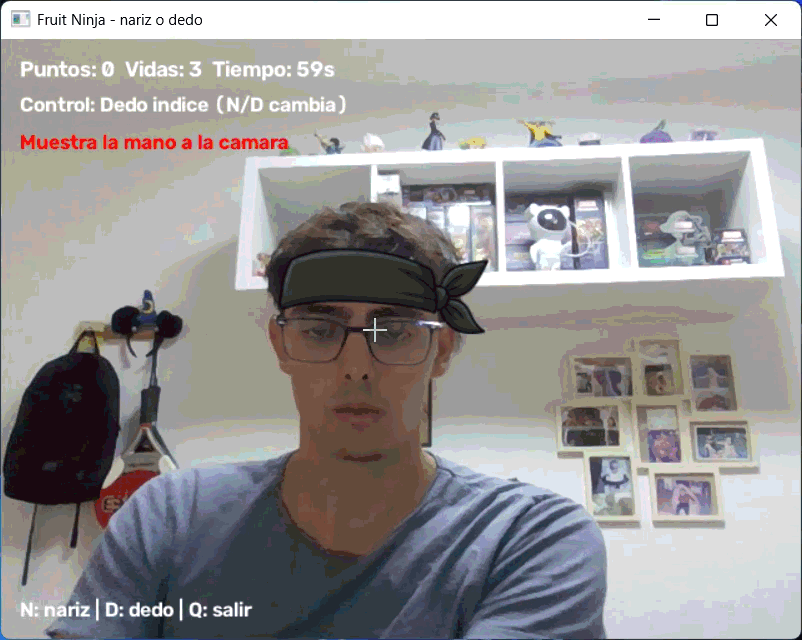

# Práctica 5. Biometría: detección y caracterización de caras

## Índice

- [Autoría](#autoría)
- [Descripción](#descripción)
- [Recursos y datos](#recursos-y-datos)
- [Entorno y ejecución](#entorno-y-ejecución)
- [Prototipo 1: filtro de emociones](#prototipo-1-filtro-de-emociones)
- [Prototipo 2: Fruit Ninja](#prototipo-2-fruit-ninja)
- [Resultados y evaluación](#resultados-y-evaluación)
- [Robustez y limitaciones](#robustez-y-limitaciones)
- [Conclusiones](#conclusiones)
- [Referencias](#referencias)
- [Uso de IA](#uso-de-ia)

## Autoría

- [Marcos Peña Armario](https://github.com/marcpear)

- [Beatriz Chaves Marrero](https://github.com/bezz75)

## Descripción

La práctica propone dos prototipos que generen una reacción a partir de información obtenida del rostro. El primero debe utilizar un modelo entrenado por el equipo para extraer información biométrica; el segundo es de temática libre. Se debe describir el detector utilizado, justificar el conjunto de datos y discutir la robustez y los resultados de cada propuesta.

### Filtro 1 — Emociones

### Filtro 2 — Fruit Ninja

Juego de cortar frutas en tiempo real. El jugador elige entre controlar el corte con la nariz o con la punta del dedo índice.

## Recursos y datos

### Filtro 1 — Emociones

- **Dataset:** 
- **Clases:**
- **Preparación:**
- **Modelo entrenado:**

### Filtro 2 — Fruit Ninja

No necesita un dataset de entrenamiento propio. Usa MediaPipe Face Landmarker para localizar la nariz y colocar la bandana, y Hand Landmarker para detectar la punta del índice. Los modelos `.task` se descargan una vez y se guardan localmente.

Las imágenes PNG se leen desde la carpeta pública [P5/FruitNinja/images](https://github.com/bezz75/VC-practica/tree/main/P5/FruitNinja/images) al iniciar el juego; se mantienen en memoria durante esa ejecución y requieren conexión a Internet.

## Entorno y ejecución

### Requisitos

- Python: [versión utilizada].
- Cámara web funcional.
- Conexión a Internet al ejecutar el juego para cargar los PNG y, la primera vez, descargar los modelos de MediaPipe.
- Paquetes: `mediapipe`, `opencv-python` y `numpy`.

Instalación inicial en Jupyter:

```python
%pip install mediapipe opencv-python numpy
```

### Filtro 1 — Emociones

### Filtro 2 — Fruit Ninja

1. Abrir `fruit_ninja_nariz.ipynb`.
2. Ejecutar las celdas en orden. Los PNG se cargan desde GitHub y los modelos de MediaPipe se descargan si no están en el directorio de trabajo.
3. Cuando aparezca la cámara, pulsar **N** para usar la nariz o **D** para usar el dedo índice.
4. Pulsar **Q** o **Esc** para salir. Al terminar una partida, pulsar **R** para reiniciarla.

La partida dura 60 segundos y empieza con tres vidas. Cortar una fruta suma 10 puntos; tocar una bomba resta una vida.

## Prototipo 1: filtro de emociones

### Resultados

## Prototipo 2: Fruit Ninja

### Pipeline

1. Se captura un fotograma de la cámara y se refleja horizontalmente.
2. Face Landmarker detecta la cara. En modo nariz se usa el landmark de la punta de la nariz como cursor; los landmarks faciales también ajustan la posición, tamaño e inclinación de la bandana.
3. En modo dedo, Hand Landmarker usa el landmark de la punta del índice como cursor.
4. Se suaviza el movimiento y se conserva una estela. La distancia entre el segmento de la estela y cada objeto determina si se corta una fruta o se toca una bomba.
5. Se actualizan gravedad, puntuación, vidas, temporizadores y partículas, y se dibuja el resultado sobre la cámara.

### Controles

- Tecla N: Control con la nariz
- Tecla D: Control con el dedo índice
- Tecla Q o Esc: Salir
- Tecla R: Reiniciar cuando acabe la partida

### Filtro 1 — Emociones y reacción

## Resultados y evaluación

### Filtro 1 — Emociones

### Filtro 2 — Fruit Ninja

**Control con el dedo**



**Control con el nariz**


## Robustez y limitaciones

### Filtro 1 — Emociones

### Filtro 2 — Fruit Ninja

- El seguimiento depende de que la cara o la mano sean visibles y estén suficientemente iluminadas.
- Si se mueve rápido puede que no se detecte bien la nariz o el dedo.

## Conclusiones

### Filtro 1 — Emociones


### Filtro 2 — Fruit Ninja

> **Pendiente:** valorar la precisión y comodidad del control con nariz y dedo, la respuesta del juego y las mejoras prioritarias.

El filtro cumple su función y es entretenido, una posible ampliación del filtro podría ser añadir otros modos o frutas que te otorguen habilidades para las partidas

## Referencias

- [README de la Práctica 4 usado como referencia de estructura](https://github.com/bezz75/VC-practica/blob/main/P4/README.md).
- [Documentación de MediaPipe Face Landmarker](https://ai.google.dev/edge/mediapipe/solutions/vision/face_landmarker).
- [Documentación de MediaPipe Hand Landmarker](https://ai.google.dev/edge/mediapipe/solutions/vision/hand_landmarker).
- [OpenCV](https://opencv.org/).
- [PNG del filtro Fruit Ninja](https://www.pngwing.com/es/search?q=frutas).

## Uso de IA

Para el filtro de Fruit Ninja se utilizó la IA para la optimización y correcíon de código, carga de imágenes y comprensión de código aportado en el [Github de la práctica](https://github.com/otsedom/otsedom.github.io/tree/main/VC/P5).

Se usó como apoyo para definir la estructura de este README corregirlo ortográficamente.
